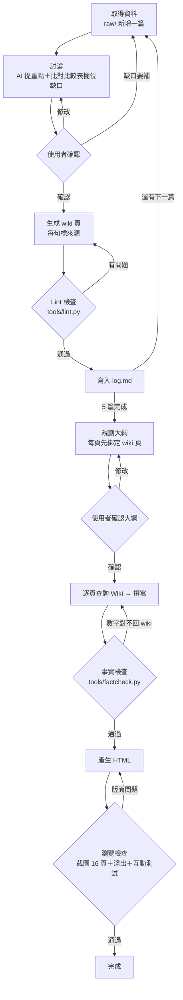

# 穩定幣與加密貨幣監管 LLM Wiki ＋ 教學 HTML 簡報

## 1. LLM Wiki 主題與簡介
**主題：穩定幣與加密貨幣監管**

給「完全不懂穩定幣的人」的入門知識庫：穩定幣是什麼、怎麼運作、央行為什麼擔心，以及美國、歐盟、香港、台灣怎麼管。
共 ingest 5 篇主來源＋1 篇補充來源，整理成 15 個 wiki 頁。

| 編號 | 原始資料 | 類型 |
|---|---|---|
| S1 | BIS 年度經濟報告 2025 第三章 | 國際組織報告 |
| S2 | 美國 GENIUS Act（CRS Insight IN12553） | 美國聯邦法律 |
| S3 | 歐盟 MiCA（＋S3b：ESMA 法條、EBA 官方說明） | 歐盟法規 |
| S4 | 香港《穩定幣條例》 | 地區法律 |
| S5 | 台灣《虛擬資產服務法》 | 台灣法律 |

## 2. LLM Wiki 連結
- 規則檔：[`AGENTS.md`](AGENTS.md)
- 原始資料：[`raw/`](raw/)
- Wiki 總目錄：[`wiki/index.md`](wiki/index.md)
- 檢查工具：[`tools/lint.py`](tools/lint.py)、[`tools/factcheck.py`](tools/factcheck.py)

## 3. 教學 HTML 簡報
- 線上瀏覽：`https://ckyyy20030201-ai.github.io/<repo 名稱>/slides/`（上傳後替換）
- 檔案：[`slides/index.html`](slides/index.html)（16 頁，鍵盤 ← → 換頁）
- 互動：第 5 頁三大檢驗翻牌卡片、第 12 頁比較表點國家切換、第 15 頁小測驗可點選作答
- 每張投影片右下角都標示對應的 wiki 頁；對照表見 [`slides/outline.md`](slides/outline.md)

## 4. Loop / Graph 設計

**文字說明：** 取得資料 → 討論 → 生成 wiki → Lint → 記錄（每篇重複）→ 規劃大綱 → 查詢 Wiki → 撰寫 → 事實檢查 → 產生 HTML → 瀏覽檢查

- **重複執行的步驟：**
  - Ingest loop：「取得 → 討論 → 生成 → Lint → 記錄」每篇資料跑一次，共 5 次
  - 簡報 loop：「查詢 Wiki → 撰寫 → 事實檢查」每張投影片跑一次
- **需要檢查或重新生成的地方：**
  - 討論後：使用者確認，不同意就重新討論；資料有缺口就回去取得資料（只允許一次，見停止條件）
  - Lint 後：斷鏈、缺來源、表格問題 → 回到生成
  - 事實檢查後：投影片數字對不回 wiki → 回到撰寫
  - 瀏覽檢查後：版面溢出或空白 → 重新產生 HTML
- **為什麼這樣設計：**
  - 「先討論、後生成」讓人在 AI 寫檔前就能刪掉不需要的內容（例如 BIS 的美債殖利率數字、AI 自己的推論），比生成後再改省事。
  - 每個生成節點後面都接一個檢查節點，因為生成節點最容易出錯，錯誤越早被抓到，越不會一路帶進簡報。
  - Wiki 是簡報唯一的知識來源，所以把來源標註當成硬規則，簡報才能做到「每頁都對得回 Wiki」。
  - 設定停止條件（比較表缺口標「資料未涵蓋」，不無限補來源），避免 loop 停不下來。

## 5. 實際執行與檢查紀錄
完整紀錄見 [`log.md`](log.md)。摘要：

| 階段 | 檢查 | 結果 |
|---|---|---|
| S1 | Lint v1 | 0 個問題 |
| S2 | Lint v1 → 發現不檢查表格 → v2 | 補規則後以錯誤複本測試成功 |
| S3 | 討論階段比對比較表 | 3 格無依據 → 補 S3b 官方來源 |
| S4 | Lint v2 → 發現「→」豁免太寬 → v3 | 抓到 AI 自行推算的句子 1 處 |
| S5 | Lint v3 ＋人工檢視 | 抓到缺來源 1 處；人工發現表格多一欄 → v4 |
| 簡報 | factcheck.py | 第 1 次 3 個問題（含 AI 編造的「15 分鐘」）→ 修正後通過 |
| 簡報 | 截圖瀏覽檢查 | 5 頁下半部空白 → 改 CSS 置中後通過 |

## 6. 反思

**哪一個節點最常出錯？**
「生成」節點，不論是生成 wiki 頁還是生成投影片。AI 會自己加東西進去：推算出「生效到發牌隔了 8 個多月」卻沒寫依據、在封面編出「15 分鐘看懂」、填表時留下多餘的空欄。這些內容看起來都很合理，所以光用眼睛看不容易發現。

第二常出錯的是「檢查節點本身」。Lint 第一版說通過，但其實它根本沒檢查表格；後來又發現只要句子含「→」就會被放過。也就是說，**檢查工具也需要被檢查**。我每次發現漏洞，都會故意做一份錯誤的複本，確認新規則真的抓得到。

**發現問題後，把檢查往前移到哪一步？**
1. **從 Lint 移到討論階段**：S2 之後，我在討論時就先拿比較表的 6 個欄位去比對原始資料，把「哪幾格沒有依據」列出來再決定怎麼處理（補來源或標「資料未涵蓋」），不是等表格生成完才發現空格。
2. **從事實檢查移到大綱階段**：規劃簡報大綱時，就要求每一頁先寫出引用哪個 wiki 頁，沒有依據的頁直接不做。

**有沒有因此修改 workflow / graph？為什麼？**
有，改了三處：
- **Lint 從 v1 升到 v4**（表格來源、收緊豁免、AI 推論須標「白話說明」、表格欄數），因為每一個漏洞都是實際跑過才發現的。
- **graph 多了一條「討論 → 取得資料」的回頭路**，資料有缺口可以回去補，但同時在 `AGENTS.md` 加了**停止條件**（只補一次，之後一律標「資料未涵蓋」），因為補來源的 loop 如果沒有上限，Wiki 範圍會一直擴大。
- **簡報段新增 `factcheck.py`**，因為生成簡報時 AI 一樣會編數字，需要一個自動化的節點把投影片數字對回 Wiki。
